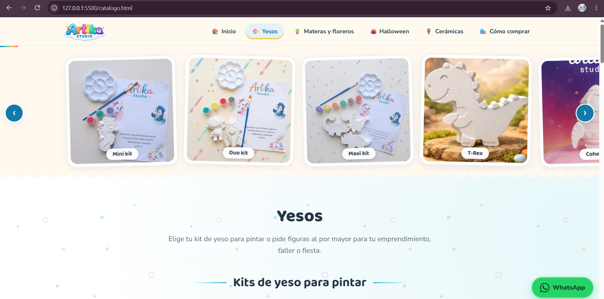

# Artika Studio · página web

Página estática hecha solo con HTML, CSS y JavaScript. No necesita instalar nada.

## Estructura

```
index.html        inicio (portada, carrusel y accesos)
catalogo.html     yesos: kits, tamaños, calculadora
figuras.html      todas las figuras de yeso por tamaño
materas.html      materas y floreros: precios por tamaño y sets pintados
temporada.html    temporada actual y otras temporadas
ceramicas.html    cerámicas pintadas y sin pintar
comprar.html      cómo comprar y preguntas frecuentes
404.html          página para direcciones que no existen
css/styles.css    los estilos
js/datos.js       ← lo único que se edita (precios, figuras, fotos, temporadas, teléfono, redes)
js/main.js        dibuja las secciones con los datos
js/extras.js      visor de fotos, botón "Pedir", vistas previas y calculadora
img/              fotos, una carpeta por sección:
                  logos, inicio (carrusel), kits, tematicas, materas, ceramicas, temporada
robots.txt  sitemap.xml  favicon.svg
```

## Qué se edita y dónde (todo en js/datos.js, con instrucciones dentro)

- **Temporada:** `TEMPORADA_ACTUAL = "auto"` cambia sola según la fecha. Para fijar una escribe su id
  (`"halloween"`, `"navidad"`, `"amor"`, `"madres"`, `"ninos"`). Las fotos de cada temporada van en su lista `items`.
  Para ver cómo se vería otro día, agrega `?fecha=2026-12-01` al final de la dirección.
- **Figuras de yeso por tamaño:** bloque `TAMANOS_YESO`.
- **Materas, floreros, joyeros:** bloque `MATERAS_TAMANOS` (precios y piezas) y `SETS_FLOREROS` (carrusel).
- **Cerámicas (pintadas y sin pintar):** bloque `CERAMICAS`.
- **Calculadora de pedido:** bloque `PRECIOS_PEDIDO`.
- **Carrusel del inicio:** bloque `GALERIA`. **Teléfono y redes:** bloque `NEGOCIO`.

Para agregar una figura: copia la foto a su carpeta dentro de `img/` (por ejemplo `img/tematicas/`; cuadrada, de unos 800 px se ve mejor) y copia una línea de otra figura.

## Publicar en GitHub Pages

1. Sube TODO el contenido de esta carpeta al repositorio (reemplazando lo anterior). `index.html` debe quedar en la raíz.
2. Settings → Pages → Deploy from a branch → `main` / `(root)`.
3. Tu página queda en `https://TU-USUARIO.github.io/artika-studio/`.

## Si compras un dominio propio

Cambia la dirección `https://collisionofstars11.github.io/artika-studio/` por la nueva en: las etiquetas `canonical` y `og:` de cada
página `.html`, `robots.txt`, `sitemap.xml` y `404.html`.

## Temáticas y logos (actualización)

- Las temáticas se editan en `js/datos.js` → `TEMATICAS` (cada figura: `img`, `nombre`, `medida`). El tamaño (grande/mediana/pequeña) se calcula solo con el número más alto de `medida`; sin medida va a "Sets y otras piezas".
- Logos: `img/logos/logo-artika.png` (encabezado), `img/logos/logo-general.png` (inicio y pie).
- Carrusel (solo en el inicio): fotos en `img/inicio/`; edita la lista `CARRUSELES` en `js/datos.js`. En datos.js las fotos se escriben con su carpeta, por ejemplo `"tematicas/t-leon-leon.jpg"`.
